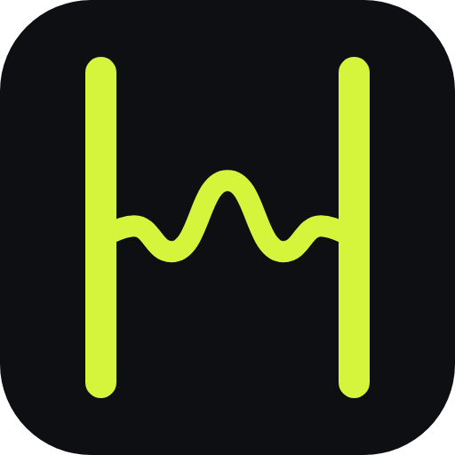
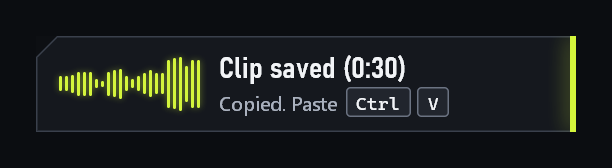
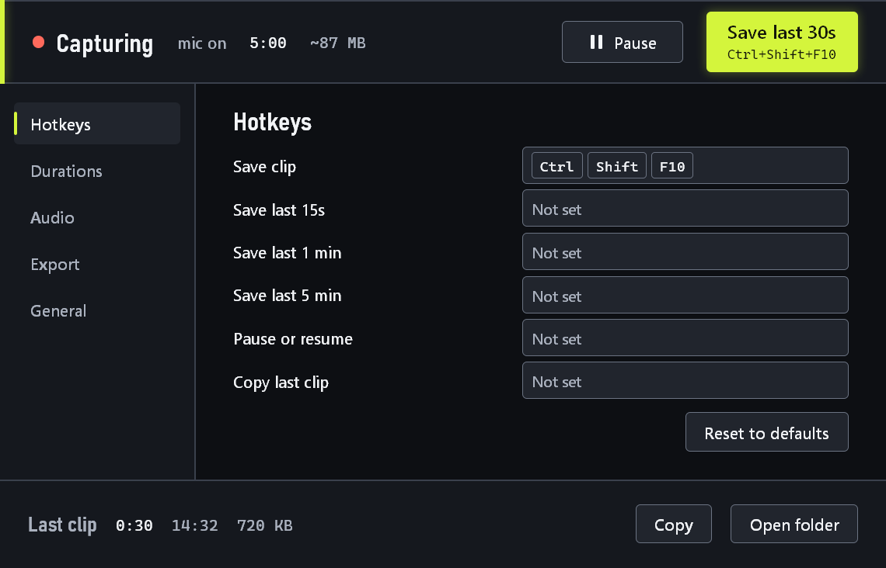
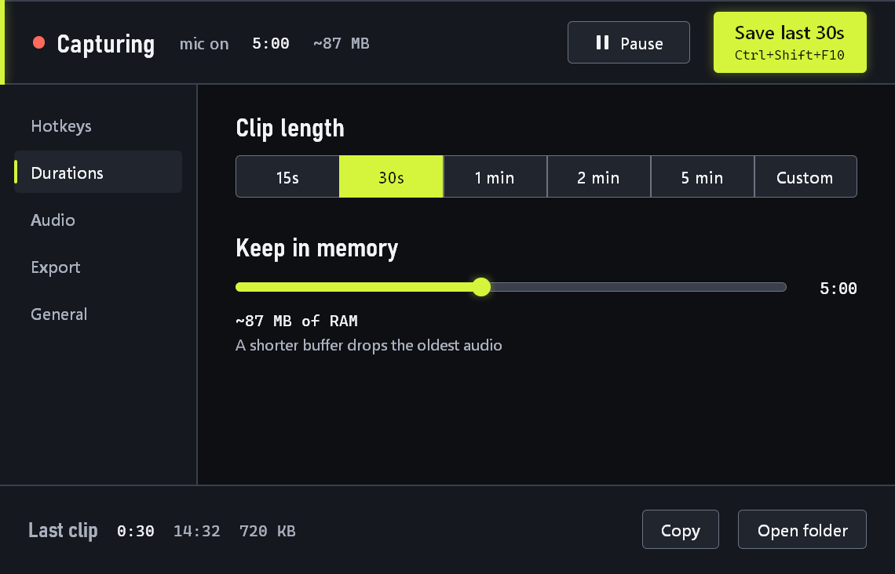
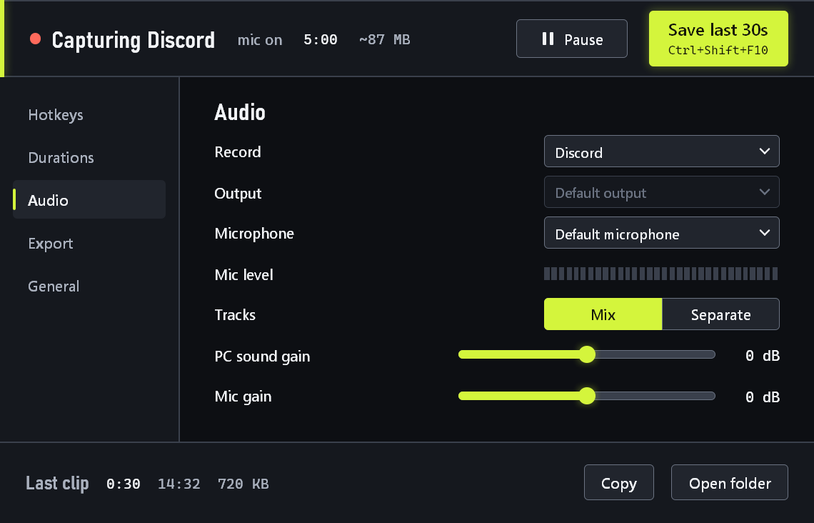
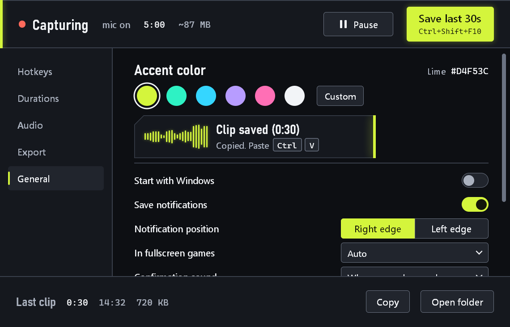

<p align="center">
  
</p>

<h1 align="center">Hindsound</h1>

<p align="center">Hit record after it happens.</p>

<p align="center">
  
  
  
  <a href="https://github.com/quelquun667/hindsound/actions/workflows/ci.yml"></a>
</p>

---

**Hindsound** runs in the background and keeps the last few minutes of your PC sound and microphone in memory. Something
funny happens in a game or a call? Press a hotkey. That past becomes a file, and the file is on your clipboard, ready to
paste into a Discord message.

<p align="center">
  
</p>

**Status:** early development. No version is published yet, but you can [build it from source](#build-from-source) today.
It has been tried on one Windows 11 PC. Not tried for real yet: pasting a clip into the Discord app, recording only a real
game or Discord, the notification in real games in exclusive fullscreen, the settings window with a real mouse and on a
second screen, unplugging a headset, Windows 10, and the windows of the Setup and its uninstaller.

## Features

- **Keeps the past:** the last 5:00 by default, in RAM. No audio goes to disk until you save.
- **One hotkey:** `Ctrl+Shift+F10` saves the last 30 seconds. The length and the hotkey are yours to change.
- **Ready to paste:** the file goes to the clipboard, so `Ctrl+V` puts it in a message.
- **PC sound and microphone:** mixed in one file, or as two separate files.
- **One application only:** record just Discord or just your game, or the whole PC (the default).
- **MP3 or WAV:** MP3 at 192 kbps by default, with the volume evened out to -16 LUFS.
- **Stays out of your game:** the notification does not take the focus, and over a game, clicks pass through it. In exclusive
  fullscreen, you get a short sound instead.
- **Your color:** six accent colors, or any bright color you type.
- **No account, no network:** the app does not use the network.

## Screenshots

| Hotkeys | Durations and memory |
| --- | --- |
|  |  |

| Recording one application | Accent color and notifications |
| --- | --- |
|  |  |

<sub>Drawn by the app itself on sample values: no real clip, device or application list is shown.</sub>

## Requirements

- 64-bit Windows, version 10 2004 or later: that is what the capture code asks for. The status at the top of this page says
  what has been tried.
- About 58 MB of RAM for the audio, or 87 MB with the microphone. See [Memory](#memory).
- To build it: the [.NET 10 SDK](https://dotnet.microsoft.com/download/dotnet/10.0). To run it: nothing else, .NET comes with it.

## Installation

There is nothing to download yet: no release has been published. Building from source already works.

### Build from source

```bash
git clone https://github.com/quelquun667/hindsound.git
cd hindsound
dotnet publish src/Hindsound/Hindsound.csproj -p:PublishProfile=win-x64
```

The result is in `src\Hindsound\bin\publish\win-x64\`. Start `Hindsound.exe` from there, and keep `libmp3lame.64.dll` next
to it: that file is the MP3 encoder.

If you want to work on the code, it is in `src/Hindsound`, and the tests are in `tests/Hindsound.Tests`:

```bash
dotnet test Hindsound.slnx --filter "Category!=Device"
```

The filter leaves out the tests that need real audio devices. To build the Setup as well, follow
[installer/README.md](installer/README.md).

### The Setup, once a version is out

1. Download `Hindsound-X.Y.Z-Setup.exe` from the [Releases page](https://github.com/quelquun667/hindsound/releases).
2. Run it. You will probably see the screen explained below.
3. Follow the Setup. It installs for your Windows user only, without administrator rights, in
   `%LocalAppData%\Programs\Hindsound`, and adds a Start menu shortcut. .NET comes with it.

### "Windows protected your PC"

Windows will probably stop the Setup with a screen titled **Windows protected your PC**.

Hindsound is not signed for now: no certificate tells Windows who published the file, so Windows warns you. This screen does
not mean a virus was found, and it does not prove the file is safe either.

1. Make sure the Setup comes from this repository's Releases page.
2. Click **More info**.
3. Click **Run anyway**.

This screen can come back with each new version.

### Updating

Hindsound does not update itself yet, and has no update setting or menu: automatic updates are on the
[Roadmap](#roadmap). For now, quit Hindsound, run `git pull`, and run the `dotnet publish` command again.

### Uninstalling

**Installed with the Setup.** Quit Hindsound first: the uninstaller refuses while it runs. Then go to Windows Settings >
Apps, find Hindsound, and uninstall it.

| | What happens |
| --- | --- |
| Program files, Start menu shortcut, the Start with Windows entry, the log | Removed |
| Your clips (`Music\Hindsound`, or the folder you chose) | Kept |
| Rescued clips (`%LOCALAPPDATA%\Hindsound\Rescued`) | Kept |
| Settings (`%AppData%\Hindsound\settings.json`) | The uninstaller asks. The default answer keeps them. |

**Built from source.** There is no uninstaller. Turn off `Start with Windows`, quit Hindsound, and delete the folder. Your
settings stay in `%AppData%\Hindsound`, and your log and rescued clips in `%LOCALAPPDATA%\Hindsound`: delete those too if
you want nothing left.

## First run

Hindsound starts capturing as soon as it starts, and sits in the notification area of the taskbar. The icon may be hidden
behind the arrow there.

The first time, with no settings file yet, a card walks you through three steps:

1. `Pick your hotkey`: keep `Ctrl+Shift+F10` or press another one.
2. `Check your mic`: speak, and the bar should move. Choose `Off` if you only want the PC sound.
3. `Try it`: say something, then press your hotkey.

The card also offers `Start with Windows`, which is off by default.

Everything Hindsound writes:

| Where | What it is |
| --- | --- |
| `Music\Hindsound` | your clips, or the folder you chose |
| `%AppData%\Hindsound\settings.json` | your settings |
| `%LOCALAPPDATA%\Hindsound\hindsound.log` | the log, for when something goes wrong |
| `%LOCALAPPDATA%\Hindsound\Rescued` | clips that could not go to your folder |

## Usage

1. Start Hindsound. A notification says `Capture on` and how much it keeps. It does so at every launch.
2. Something happens that you want to keep. Press `Ctrl+Shift+F10`.
3. A notification says `Clip saved (0:30)` and `Copied. Paste Ctrl V`.
4. In Discord, click the message box, press `Ctrl+V`, and send.

Good to know:

- **File names** look like `Hindsound_Discord_2026-11-06_21-14-03.mp3`. The `Discord` part is the title of the active window
  when you pressed the hotkey, or `Unknown` if it has none.
- **A short start:** if Hindsound started 12 seconds ago, you get those 12 seconds: `Clip saved (0:12 of 0:30)`.
- **In exclusive fullscreen,** you hear a short sound instead of seeing the notification, because a window over the game
  could throw it out of fullscreen. The notification shows when you are back on the desktop, within 30 seconds for a normal
  clip, and at any time for a clip that had a problem. A borderless game gets the notification right away, unless you set
  `In fullscreen games` to `Sound only`.
- **A click on the notification,** on the desktop, opens your clips folder, or the settings if it reports a problem there.
- **The icon:** a left click opens the settings. A right click opens the menu: `Save last 30s`, `Save last 15s`,
  `Save last 1 min`, `Save last 5 min`, `Copy last clip`, `Pause capture`, `Open clips folder`, `Settings`, `Quit`.
- **Starting Hindsound again** while it runs opens the settings of the one already running.
- **Quitting during a save:** Hindsound finishes the clip first, for 5 minutes at most. A second `Quit` leaves at once.

### Hotkeys

| Action | Default |
| --- | --- |
| `Save clip` (the length set in Durations) | `Ctrl+Shift+F10` |
| `Save last 15s` | Not set |
| `Save last 1 min` | Not set |
| `Save last 5 min` | Not set |
| `Pause or resume` | Not set |
| `Copy last clip` | Not set |

You can change them all in Settings > Hotkeys. If another app already holds a combination, Hindsound says so.

## Settings

A left click on the icon opens them. There is no OK button: a change is saved at once, in `%AppData%\Hindsound\settings.json`.

| Page | Setting | Choices (default in bold) |
| --- | --- | --- |
| Durations | Clip length | 15s, **30s**, 1 min, 2 min, 5 min, Custom (up to 30:00) |
| Durations | Keep in memory | 1:00 to 10:00, **5:00**. A longer clip stretches the slider, up to 30:00. The page shows the RAM it takes. |
| Audio | Record | **Whole PC**, or one application |
| Audio | Output | **Default output**, or one device |
| Audio | Microphone | **Default microphone**, one device, or Off |
| Audio | Tracks | **Mix** (one file), or Separate (two files, ending in `_system` and `_mic`) |
| Audio | PC sound gain, Mic gain | Sliders from -24 to +24 dB, **0 dB** |
| Export | Format | WAV, **MP3** |
| Export | MP3 quality | 128, **192**, 320 kbps |
| Export | Volume | Off, Peak, **Loudness** (-16 LUFS) |
| Export | Folder | **`Music\Hindsound`**, or the folder you pick |
| Export | File name | **`Hindsound_{app}_{date}_{time}`**. These three tags are the only ones. |
| Export | Copy clip to clipboard | **On** |
| General | Accent color | **Lime**, Mint, Cyan, Violet, Pink, White, Custom |
| General | Start with Windows | **Off** |
| General | Save notifications | **On** |
| General | Notification position | **Right edge**, Left edge |
| General | In fullscreen games | **Auto**, Sound only |
| General | Confirmation sound | **When no overlay can show**, Always, Never. The beep can be heard in your next clip if you capture a specific output. |

### Record one application

`Record` can follow one application instead of the whole PC: only Discord, or only your game. The list shows the
applications that have an audio session, so an application that has played nothing yet is not in it.

- Hindsound remembers the application by the name of its exe.
- If the application closes, the band says `Not running: Discord`, and the memory gets silence. The capture attaches again
  when the application comes back. None of this makes a notification.
- `Output` is greyed out in this mode: the capture does not depend on an output.
- The microphone keeps its own setting. Set it to `Off` if you only want the application.

### Memory

Hindsound keeps audio in RAM, so its memory follows the length you keep. The audio takes 192 KB/s for the PC sound and 96 KB/s
for the microphone. For 5:00, that is about 58 MB without the microphone and 87 MB with it. Settings > Durations shows this
estimate as you move the slider.

The whole app with 5:00 kept, measured on one PC on 2026-11-06:

| Case | Memory |
| --- | --- |
| Mic off, private memory from the start of the capture | 62.5 MB |
| Mic off, working set after 3 s | 32 MB |
| Mic off, working set after 123 s | 53.8 MB |
| Mic off, working set with the memory full | About 85 MB (extrapolated, not measured) |
| Mic on, private memory | 94 MB |

Saving takes more, only while the clip is written, with both sources on: 17 MB for 30 seconds, 173 MB for 5:00.

## Recording other people

Recording a call or a voice chat without telling the other people can be illegal where you live. Tell them first.

The `Capture on` notification at each launch reminds you, not the people in the call. Telling the group is up to you.

### Your game

Hindsound does not touch your game. It injects nothing, sets no hook, and opens no handle to the game. The `{app}` part of a
file name comes only from the title of the active window. With `Record` set to one application, Hindsound looks for it in a
list of processes that Windows gives, every 3 seconds, and takes its sound through the audio API of Windows.

This is not a promise about any anti-cheat: it has not been tried against one, and no anti-cheat publisher guarantees it.

## Troubleshooting

| What you see | What it means |
| --- | --- |
| `Hotkey already in use by another app`, in Settings > Hotkeys | Another program holds this combination. Press another one. |
| `Capture on`, with `Save hotkey is taken` | Your save hotkey does nothing for now. A click on the notification opens the settings, where you can change it. |
| `Output folder not writable`, `Clip kept in Hindsound\Rescued` | Your clip is safe in `%LOCALAPPDATA%\Hindsound\Rescued`. Pick another folder in Settings > Export. |
| `Saved as WAV. Paste` or `Saved as WAV. MP3 failed.` | The MP3 encoder failed. Your clip is there as a WAV file. |
| `It's silent. Check Settings > Audio.` | The clip was saved but holds no sound. Check `Record`, `Output` and `Microphone`. |
| `Couldn't copy. Use tray > Copy last clip.` | The file is saved, but the clipboard refused it. Right-click the icon and choose `Copy last clip`. |
| `Couldn't save the clip`, `The reason is in hindsound.log` | Look in `%LOCALAPPDATA%\Hindsound\hindsound.log`. |
| `Settings file was damaged`, `Defaults restored, mic off` | Hindsound could not read `settings.json`, so it went back to the defaults with the microphone off. It keeps a copy of the old file as `.bak` when it can. |

If something else goes wrong, [open an issue](https://github.com/quelquun667/hindsound/issues/new/choose). The log is in
`%LOCALAPPDATA%\Hindsound\hindsound.log`. Read it before you paste it: it holds window titles and file paths, and issues are
public.

## Roadmap

- The first release, with the Setup
- Automatic updates
- Mac and Linux versions, with no date yet

## License

[MIT](LICENSE). The third-party licenses are in [THIRD-PARTY-NOTICES.md](THIRD-PARTY-NOTICES.md).

## Acknowledgments

- [NAudio](https://github.com/naudio/NAudio): audio capture
- [NAudio.Lame](https://github.com/Corey-M/NAudio.Lame): the bridge to the MP3 encoder
- [LAME](https://lame.sourceforge.io/): the MP3 encoder, under the LGPL
- [.NET](https://github.com/dotnet/runtime): the runtime, and System.Numerics.Tensors
- [Inno Setup](https://jrsoftware.org/isinfo.php): the installer
