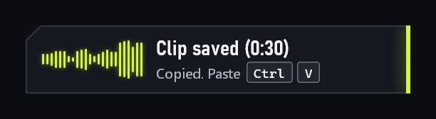
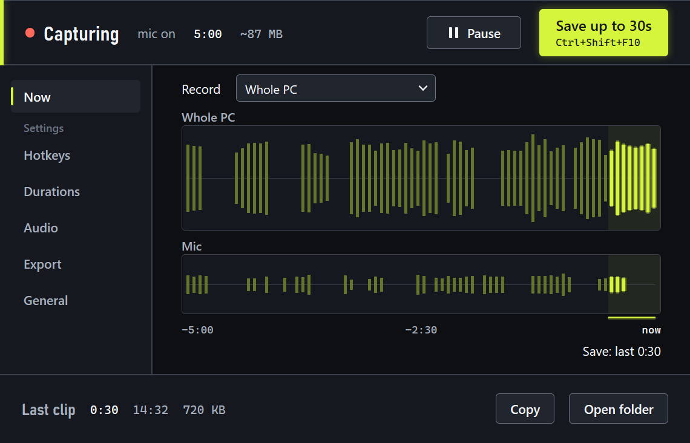
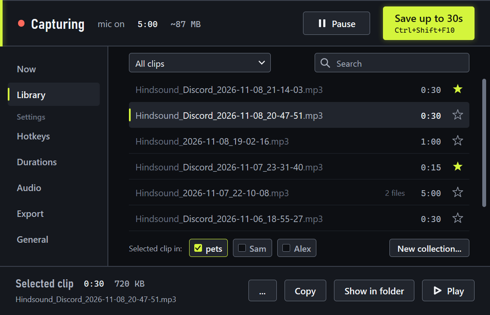
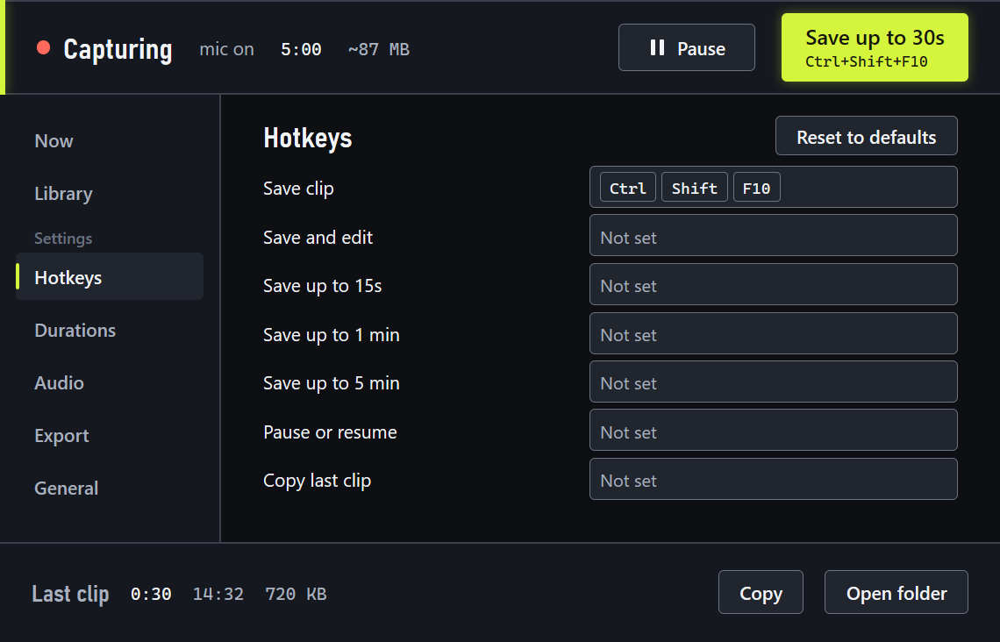
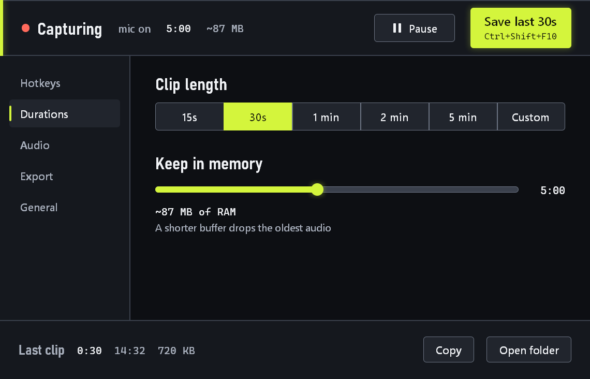
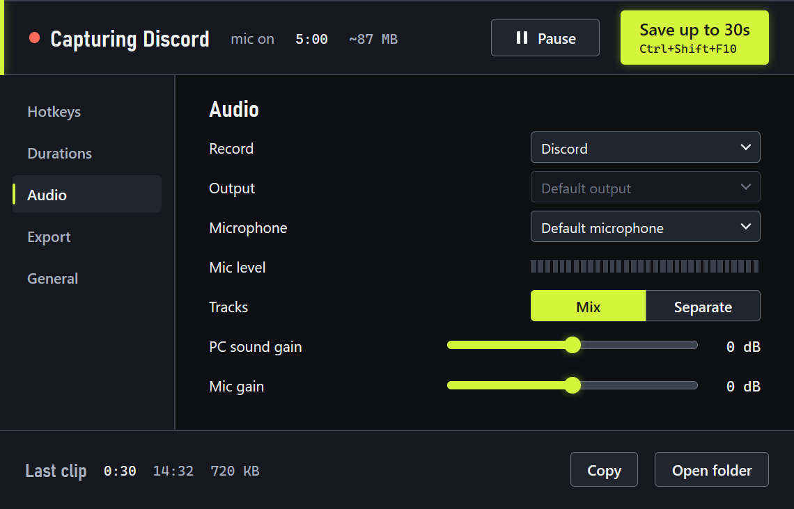
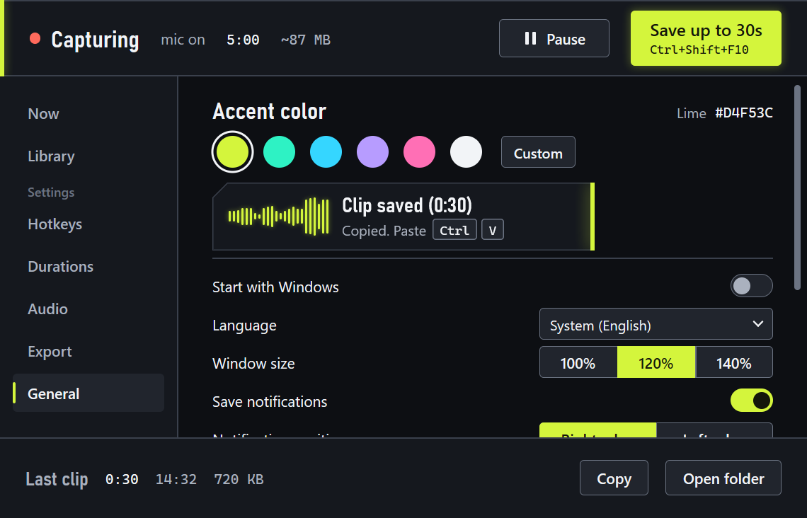

<p align="center">
  
</p>

<h1 align="center">Hindsound</h1>

<p align="center">Hit record after it happens.</p>

<p align="center">
  
  
  
  <a href="https://github.com/quelquun667/hindsound/actions/workflows/ci.yml"></a>
</p>

---

https://github.com/user-attachments/assets/b2339523-396f-4d1c-ae00-4fd431cd5cf7

**Hindsound** runs in the background and keeps the last few minutes of your PC sound and microphone in memory. Something
funny happens in a game or a call? Press a hotkey. That past becomes a file, and the file is on your clipboard, ready to
paste into a Discord message.

<p align="center">
  
</p>

**Status:** early development. The Setup is on the [Releases page](https://github.com/quelquun667/hindsound/releases), and you can also [build it from source](#build-from-source).
It has been tried on one Windows 11 PC, and some things are [not tried yet](#not-tried-yet). A first Linux version, with no
window, comes with the releases after 0.5.0, and the releases after 0.7.0 add its window: see [Linux](#linux).

## Features

- **Keeps the past:** up to 5:00 by default, in RAM, filling from the moment it starts. No audio goes to disk until you save.
- **One hotkey:** `Ctrl+Shift+F10` saves up to the last 30 seconds. The length and the hotkey are yours to change.
- **Ready to paste:** the file goes to the clipboard, so `Ctrl+V` puts it in a message.
- **PC sound and microphone:** mixed in one file, or as two separate files.
- **One application only:** record just Discord or just your game, or the whole PC (the default).
- **MP3 or WAV:** MP3 at 192 kbps by default, with the volume evened out to -16 LUFS.
- **Stays out of your game:** the notification does not take the focus, and over a game, clicks pass through it. In exclusive
  fullscreen, you get a short sound instead.
- **Your clips in one list:** the `Library` page shows them newest first, with their length, and copies one or shows it in its
  folder. Star your favorites and tick them into your own collections. Rename or delete a clip from its menu; a deleted clip
  goes to the Recycle Bin.
- **Cut and turn up:** open a clip, keep the part you want between two handles, turn its volume up or down, and save a copy or
  replace it. A part of 5.2 seconds or less can go to the Discord soundboard.
- **Your color:** six accent colors, or any bright color you type.
- **English or French:** the whole window and the notifications, following the language of the system unless you choose one.
- **No account:** the only network use is the daily check for a new version, which you can turn off. See [Updates](#updates).

## Screenshots

| Now: what the memory holds | Library: your clips |
| --- | --- |
|  |  |

| Hotkeys | Durations and memory |
| --- | --- |
|  |  |

| Recording one application | Accent color and notifications |
| --- | --- |
|  |  |

<sub>Drawn by the app itself on sample values: no real clip, device or application list is shown.</sub>

## Requirements

- 64-bit Windows, version 10 2004 or later: that is what the capture code asks for. Only Windows 11 has been tried.
  Recording one application may need a newer build of Windows 10 than 2004; this has not been checked.
- About 62 MB of RAM for the whole app with a 5:00 buffer and no microphone, 94 MB with it. The audio alone is 58 MB, or
  87 MB with the microphone. See [Memory](#memory).
- To build it: the [.NET 10 SDK](https://dotnet.microsoft.com/download/dotnet/10.0). To run it: nothing else, .NET comes with it.
- On Linux and macOS, see [Linux](#linux) and [macOS](#macos).

## Installation

Download it from the [Releases page](https://github.com/quelquun667/hindsound/releases), or build it from source. Each
release holds:

| File | For |
| --- | --- |
| `Hindsound-X.Y.Z-Setup.exe` | Windows, recommended: it installs Hindsound for your user and keeps it up to date. See [The Setup](#the-setup). |
| `Hindsound-X.Y.Z-win-x64-portable.zip` | Windows, without installing anything. See [The portable zip](#the-portable-zip). |
| `hindsound-X.Y.Z-linux-x64.AppImage` | Linux: one file to run. See [Linux](#linux). |
| `hindsound-X.Y.Z-linux-x64.tar.gz` | Linux, where the AppImage does not run: a folder to unpack. See [Linux](#linux). |
| `hindsound_X.Y.Z_amd64.deb` | Ubuntu 22.04 and later, Debian 12 and later: a package to install with `apt`. See [Linux](#linux). |
| `Hindsound-X.Y.Z-macos-arm64.zip` | macOS 14.4 and later (tried on macOS 15 and 26 only, in the CI), on a Mac with Apple silicon: the app, in a zip. See [macOS](#macos). |
| `SHA256SUMS` | The SHA-256 of every file of the release. |

The portable zip, the AppImage and the tar.gz come with the releases after 0.5.0, and the `.deb` with the releases after
0.8.0. The `.json` files of a release are read by Hindsound to learn about a new version, and `lame-3.100.tar.gz` is the
source of its MP3 encoder.

### Build from source

```bash
git clone https://github.com/quelquun667/hindsound.git
cd hindsound
dotnet publish src/Hindsound/Hindsound.csproj -p:PublishProfile=win-x64
```

The result is in `src\Hindsound\bin\publish\win-x64\`. Start `Hindsound.exe` from there, and keep `libmp3lame.64.dll` next
to it: that file is the MP3 encoder.

If you want to work on the code, the part that calls no Windows API is in `src/Hindsound.Core`, the Windows layer and the
exe are in `src/Hindsound`, and their tests are in `tests/Hindsound.Core.Tests` and `tests/Hindsound.Tests`:

```bash
dotnet test Hindsound.slnx --filter "Category!=Device"
```

The filter leaves out the tests that need real audio devices. To build the Setup as well, follow
[installer/README.md](installer/README.md).

### The Setup

1. Download `Hindsound-X.Y.Z-Setup.exe` from the [Releases page](https://github.com/quelquun667/hindsound/releases).
2. Run it. You will probably see the screen explained below.
3. Follow the Setup. It installs for your Windows user only, without administrator rights, in
   `%LocalAppData%\Programs\Hindsound`, and adds a Start menu shortcut. .NET comes with it.

### The portable zip

1. Download `Hindsound-X.Y.Z-win-x64-portable.zip` from the [Releases page](https://github.com/quelquun667/hindsound/releases).
2. Unzip it where you want to keep Hindsound, and start `Hindsound.exe` in the folder. You will probably see the screen
   explained below.

Keep `libmp3lame.64.dll` and `portable.txt` next to `Hindsound.exe`: the first is the MP3 encoder, the second makes the copy
portable. A portable copy never updates itself: when a new version is out, it says so, and its link opens the page of the
release. Its settings are in `%AppData%\Hindsound`, as for the Setup.

### "Windows protected your PC"

Windows will probably stop the Setup, or `Hindsound.exe` from the portable zip, with a screen titled **Windows protected
your PC**.

Hindsound is not signed for now: no certificate tells Windows who published the file, so Windows warns you. This screen does
not mean a virus was found, and it does not prove the file is safe either.

1. Make sure the file comes from this repository's Releases page.
2. Click **More info**.
3. Click **Run anyway**.

This screen can come back with each new version.

### Updating

An installed Hindsound updates itself, see [Updates](#updates). The portable zip never does: when a new version is out, it
says so; download the new zip, quit Hindsound, and replace the files of its folder with those of the new zip. A build from
source never does either: quit Hindsound, run `git pull`, and run the `dotnet publish` command again.

### Uninstalling

**Installed with the Setup.** Quit Hindsound first: the uninstaller refuses while it runs. Then go to Windows Settings >
Apps, find Hindsound, and uninstall it.

| | What happens |
| --- | --- |
| Program files, Start menu shortcut, the Start with Windows entry, the log | Removed |
| Your clips (`Music\Hindsound`, or the folder you chose) | Kept |
| Rescued clips (`%LOCALAPPDATA%\Hindsound\Rescued`) | Kept |
| Settings and collections (`%AppData%\Hindsound\settings.json` and `library.json`) | The uninstaller asks once for both. The default answer keeps them. A silent uninstall keeps them. |

**The portable zip, or built from source.** There is no uninstaller. Turn off `Start with Windows`, quit Hindsound, and
delete the folder. Your settings and collections stay in `%AppData%\Hindsound`, and your log, rescued clips and the state
of the update checks (`updates-portable` for the portable zip) in `%LOCALAPPDATA%\Hindsound`: delete those too if you
want nothing left.

### Linux

A first Linux version, for 64-bit Ubuntu 22.04 and later, comes with the releases after 0.5.0, with no window; the
releases after 0.7.0 add the window (see [The window on Linux](#the-window-on-linux) below). From the
start it captures the sound of the whole PC, and the microphone if your settings name one. It saves a clip on its hotkey,
on `hindsound --save` or from the menu of its icon, says so with a notification, and copies the clip when the desktop
allows it. A click on the notification of a clip shows the clip in its folder.

**Download.** From the [latest release](https://github.com/quelquun667/hindsound/releases/latest): the AppImage and the
tar.gz come with the releases after 0.5.0, the .deb with the releases after 0.8.0. Between releases, the CI builds the
same files on every change: open a recent run of the
[CI workflow](https://github.com/quelquun667/hindsound/actions/workflows/ci.yml) on `main`, and download the
`hindsound-linux-x64` artifact (GitHub asks you to sign in). A release after 0.8.0, like the artifact, has the program three
times, and the releases from 0.6.0 to 0.8.0 the first two; take one:

- `hindsound-<version>-linux-x64.AppImage`, one file. A download does not keep its executable bit, so give it back.
  Give it a name that stays before the first run, as the shortcut below and `Start with the session` point to it:

  ```sh
  mkdir -p ~/Applications
  mv hindsound-*-linux-x64.AppImage ~/Applications/Hindsound.AppImage
  chmod +x ~/Applications/Hindsound.AppImage
  ~/Applications/Hindsound.AppImage
  ```

- `hindsound-<version>-linux-x64.tar.gz`, a folder to unpack. Its `README.txt` says how to install it in `~/.local`, or
  run it from where it is:

  ```sh
  tar -xzf hindsound-*-linux-x64.tar.gz
  ./hindsound-*-linux-x64/hindsound
  ```

- `hindsound_<version>_amd64.deb`, a package for Ubuntu 22.04 and later and Debian 12 and later. Install it from the
  folder where you downloaded it, with the version of the file in place of `X.Y.Z` (the `./` tells `apt` it is a file),
  then start Hindsound from the list of applications, or run `hindsound`. On Ubuntu, `apt` may add a note that the
  "Download is performed unsandboxed as root": for a file already on your PC, it changes nothing.

  ```sh
  sudo apt install ./hindsound_X.Y.Z_amd64.deb
  ```

  If you ran the AppImage or the tar.gz before, see **From the AppImage to the .deb** below.

  It puts the program in `/usr/lib/hindsound`, with its MP3 encoder, SDL 3 and the fonts, and `/usr/bin/hindsound`, a
  link to it. `apt` installs what it needs from the system: the sound library, FreeType, HarfBuzz, fontconfig and OpenSSL.
  Unless your `apt` skips recommended packages, it also adds a clipboard tool for `Copy` (`wl-clipboard`, `xclip` or
  `xsel`), `xdg-utils`, which opens folders and links, and the certificates the update check needs (`ca-certificates`).

All three bring what the window needs that a desktop may lack: SDL 3 and the fonts. The rest, FreeType, HarfBuzz and
fontconfig, comes with every desktop install, so the AppImage and the tar.gz ask you to install nothing more.

`SHA256SUMS`, next to them, has their checksums: run `sha256sum --check --ignore-missing SHA256SUMS` in the folder where
you downloaded them.

`fuse-3.15.0.tar.xz`, `type2-runtime-20251108-source.tar.gz` and `type2-runtime-20251108-libraries-source.tar.gz`, also
next to them in the release and in the artifact, are the source of libfuse, of the runtime at the head of the AppImage and
of the other libraries linked into that runtime, offered under the LGPL-2.1 of libfuse: Hindsound does not need them to
run.

**In the list of applications.** On its first launch from the AppImage or from the unpacked folder, Hindsound adds itself
to the list of applications: it writes `~/.local/share/applications/io.github.quelquun667.Hindsound.desktop`, which starts
the file you launched, and its icon in `~/.local/share/icons/hicolor/<size>/apps/`. The shortcut portal knows an app only
by this entry. A launch from elsewhere writes it again; an entry installed by a package of the system is never covered. To
take it away, delete the entry and the icons. The .deb installs its own entry and icons in `/usr/share`, and Hindsound
then writes none in `~/.local`.

**From the AppImage to the .deb.** The entry the AppImage or the tar.gz wrote in `~/.local` has the name of the .deb's,
and goes before it. So once the .deb is installed, the next launch of Hindsound, from the list of applications or from
anywhere else, removes that entry and those of its icons that are the same as the package's, and says so in its log.
That launch may still be the old copy; the ones after it start the .deb, and an AppImage started then writes no entry.
An entry you changed or hid stays: delete it yourself. `Start with the session` stays with the copy that turned it on:
the .deb shows it off, so turn it on there, and the session starts the .deb from then on.

If you copied the tar.gz into `~/.local` with the steps of its `README.txt`, remove that copy before you install the
.deb, with the list of files under Uninstall in the same `README.txt`. Hindsound does not do it: `~/.local/bin` comes
before `/usr/bin` on the PATH, so `hindsound`, and the list of applications with it, would keep starting that copy.

**Save from a key.** On X11, and on Wayland where the desktop offers global shortcuts (GNOME 48 and later, so Ubuntu
26.04, and KDE), Hindsound uses its hotkey. Ubuntu 24.04 on Wayland has no such shortcuts: open Settings > Keyboard >
View and Customize Shortcuts > Custom Shortcuts, add one, and set its command to the full path of the program followed by
`--save`, for example `/home/you/Applications/Hindsound.AppImage --save`, or `/usr/lib/hindsound/hindsound --save` for the
.deb.

**The icon** sits next to the clock, through StatusNotifierItem. On GNOME it needs the AppIndicator extension, which
Ubuntu has already. Its menu saves a clip, pauses or resumes, opens the folder of the clips, turns `Start with the
session` on or off, and quits.

**Settings** are in `~/.config/Hindsound/settings.json`, the same file as on Windows (see [Settings](#settings)). The
settings window edits it; without the window, edit it by hand while Hindsound is not running.

#### The window on Linux

From the releases after 0.7.0, a launch or a click on the icon opens the same window as on Windows: `Now`, `Library` and
the settings. The packages bring SDL 3.2, which draws it, and its fonts: Selawik, Barlow Semi Condensed and Cascadia
Mono. FreeType, HarfBuzz and fontconfig come from the system, as on any desktop. If one of them is missing, Hindsound runs
without the window, as before, and its log says why. The window's SDL needs glibc 2.34 or later, which Ubuntu 22.04 and
the later systems Hindsound is made for already have.

- Listening to a clip: while it plays, the capture of the PC's sound records silence, so the clip does not end up in the
  next one. The microphone keeps recording.
- `Record` can follow one application and its child processes, as on Windows, through PulseAudio or PipeWire. An
  application is in its list only while it plays sound: start a sound in it, then choose it. See
  [Record one application](#record-one-application).
- `Delete`, and an edit saved in place of its original, send the file to the Trash of the desktop.
- The `Hotkeys` page shows keys typed in a field on X11, the keys the desktop chose under its shortcut portal (change them
  in the shortcut settings of the desktop), or, with neither, the command to bind to a key, with a `Copy` button.
- The settings leave out what the notification of the desktop does not have: its look, its position and the
  confirmation sound.

**Updates.** When a new version is out, a notification says so, with the link to its release. Nothing installs itself:
replace the file. For the .deb, download the new one from that release and install it the same way, with
`sudo apt install ./hindsound_<version>_amd64.deb`: it replaces the old version. `apt upgrade` does not see it, as no
repository serves it.

**Not there yet:** any processor other than x64.

**Remove it.** Before you delete the AppImage (or the program), turn `Start with the session` off in the menu of the icon,
or delete `~/.config/autostart/io.github.quelquun667.Hindsound.desktop`: otherwise your session tries to start a file that
is gone at each login. Then delete the program. Hindsound leaves these, and you can delete them too:

- `~/Music/Hindsound`, or the folder your settings name: your clips.
- `~/.config/Hindsound`: the settings.
- `~/.local/share/Hindsound`: the log, the clips rescued after a failed save (`Rescued`) and the state of the update
  check (`updates`).
- `~/.local/share/applications/io.github.quelquun667.Hindsound.desktop` and
  `~/.local/share/icons/hicolor/*/apps/io.github.quelquun667.Hindsound.png`: its entry in the list of applications and its
  icons, written at its first launch.

If you installed the tar.gz into `~/.local`, its `README.txt` lists the files to remove.

For the .deb, turn `Start with the session` off first too: the entry in `~/.config/autostart` names
`/usr/lib/hindsound/hindsound`, which `apt` removes, and stays behind; the session then skips it. Then:

```sh
sudo apt remove hindsound
```

It removes everything the package installed. Your clips, the settings, the log and the files in your home folder above stay.

**Build it.** With the .NET 10 SDK, on Linux or Windows:

```sh
dotnet publish src/Hindsound.Linux/Hindsound.Linux.csproj -c Release -r linux-x64 --self-contained -p:PublishSingleFile=true -p:PublishTrimmed=true
```

For MP3 the program uses `libmp3lame.so.0`, which the packages put next to it. The CI builds that library with
`tools/release/build-lame-linux.sh`, builds `libSDL3.so.0` with `tools/linux/build-sdl3.sh`, fetches the fonts of the
window with `tools/linux/fetch-fonts.sh`, then makes the AppImage and the tar.gz with `packaging/linux/build-packages.sh`.
The program looks for its fonts in the folder `HINDSOUND_FONT_DIR` names, or else in `fonts` next to it.

The Linux layer is in `src/Hindsound.Linux`. What it would share as it is with another system than Windows (the SDL
window, the loop of the app, the single instance, the HTTP transport, the decoder of the clips and the MP3 encoder) is in
`src/Hindsound.Unix`, which it references. The tests of both are in `tests/Hindsound.Linux.Tests`.

### macOS

A first Mac version, for a Mac with Apple silicon (M1 or later) on macOS 14.4 or later, comes with the releases after
0.10.1. There is no build for Intel Macs yet. It has the same window as on Windows and Linux, and captures the sound of the
whole Mac (Hindsound itself left out), or one application and its child processes, and the microphone if your settings
name one. It saves a clip on its hotkey, on `hindsound --save` or from the menu of its icon in the menu bar, says so with
its own notification, as on Windows, and puts the clip on the clipboard as a file.

**No one has tried it on a real Mac yet.** Everything in this section has only run on the macOS machines of GitHub's CI,
on Apple silicon: the app is built, signed, unzipped and started there, and the CI runs the app and all its proofs on
macOS 26 and on macOS 15 (15.8.2): its window drawn off screen, its MP3 encoder and its capture checked with a test tone
played through a virtual sound device, the permissions written by the CI itself. A hotkey follows the keyboard layout, as on
Windows: `Ctrl+Option+A` is the key that types an A, on an AZERTY keyboard as on a QWERTY one, a change of layout while
Hindsound runs puts the hotkeys back on the right keys, and a hotkey whose key another app holds waits, with the `Hotkeys`
page showing it in use. The CI proves it by reading the French, German and Dvorak layouts; no real key has been pressed on a
real keyboard. GitHub removed its macOS 14 machines in November 2026, so macOS 14 has never run it: 14.4 stays the minimum
the app declares, but it is not tried. When the default sound output changes while Hindsound records, it opens the capture
again on the new output and hears a tone played there: the CI proves it by changing the default output from BlackHole 2ch
to the Null Audio Device under a running capture. A click on the notification of a clip opens the Library, as on Windows,
and it comes in front, with Hindsound the active app: the CI proves it with a click of the system on the notification. Pasting into a real app, a real hotkey pressed on a real keyboard, the prompts of macOS answered
by a person, macOS 14, and a real game or call have not been tried. If something does not work, the log is in `~/Library/Logs/Hindsound/hindsound.log`; an issue with it helps.

**Download.** `Hindsound-<version>-macos-arm64.zip` from the
[latest release](https://github.com/quelquun667/hindsound/releases/latest). Between releases, the CI builds the same file
on every change: open a recent run of the [CI workflow](https://github.com/quelquun667/hindsound/actions/workflows/ci.yml)
on `main`, and download the `hindsound-macos-arm64` artifact (GitHub asks you to sign in; it is a zip that holds the zip).
Open the zip in the Finder, and move `Hindsound.app` to `Applications`.

**The first launch.** Hindsound is not signed by an Apple developer account nor notarized, so macOS blocks it the first
time with a message that it could not verify it. Click `Done`, then open System Settings > Privacy & Security (the names
of macOS 15 and later; they may differ on macOS 14), scroll to the message about Hindsound, click `Open Anyway`, and confirm with your password. Each new version asks this once again.
Or, in Terminal, remove the mark that the download put on the app, then open it as any other:

```sh
xattr -dr com.apple.quarantine /Applications/Hindsound.app
```

**Two permissions.** At its first capture, macOS asks whether Hindsound may record the sound of the system (`System Audio
Recording`), and, if your settings name a microphone, whether it may use the microphone. Without them, macOS gives
Hindsound silence. After 2 seconds of it, if macOS reports the permission refused, Hindsound stops that capture; the window
only shows that it is not capturing, and the log (`~/Library/Logs/Hindsound/hindsound.log`) says which permission is
missing. To give them back, or to take them away, open System Settings > Privacy & Security > Screen & System Audio
Recording (the list `System Audio Recording Only`), and Privacy & Security > Microphone, then quit and start Hindsound
again (the names of macOS 15 and later; they may differ on macOS 14).

macOS keeps these permissions for one signature of the app. For now each version is signed ad hoc, so macOS takes it for
another app and asks again for both permissions after every update: answer as the first time. Once the releases are signed
with the certificate of Hindsound, an update keeps them. To see which one you have, run
`codesign -dv /Applications/Hindsound.app` in Terminal: `Signature=adhoc` is the first kind.

**The icon and the hotkey.** Hindsound has no icon in the Dock: it is in the menu bar, with the same menu as on Windows.
The hotkeys are set in Settings > Hotkeys, as on Windows, with `Control`, `Option`, `Shift` and `Cmd`. To save a clip from elsewhere, such as a shortcut of the Shortcuts app or of another keyboard tool, run the program inside
the app with `--save`:

```sh
/Applications/Hindsound.app/Contents/MacOS/hindsound --save
```

It reaches the Hindsound that is running. If none is, it opens `Hindsound.app` as the Finder does, so that Hindsound
does not depend on Terminal or on the Shortcuts app, and leaves: the next `--save` saves a clip.

**Where things are.** Settings in `~/Library/Application Support/Hindsound/settings.json`, the same file as on Windows (see
[Settings](#settings)); the log in `~/Library/Logs/Hindsound`; clips in `~/Music/Hindsound`. `Open at login`, in Settings > General, adds Hindsound
to the apps that open when you log in. To remove Hindsound, quit it, turn `Open at login` off first, and move
`Hindsound.app` to the Trash; delete the folders above too if you want nothing left.

**What is not there.** No confirmation sound plays when a clip is saved, and the settings offer none. Hindsound does not
update itself: once a day it checks whether a new version is out, and tells you with a link to its release, as the Linux
app does.

The Mac layer is in `src/Hindsound.Mac`, and its tests in `tests/Hindsound.Mac.Tests`. `packaging/mac/build-app.sh` makes
the app from a build.

## First run

Hindsound starts capturing as soon as it starts, and sits in the notification area of the taskbar. The icon may be hidden
behind the arrow there.

The first time, with no settings file yet, a card walks you through three steps:

1. `Pick your hotkey`: keep `Ctrl+Shift+F10` or press another one.
2. `Check your mic`: speak, and the bar should move. Choose `Off` if you only want the PC sound.
3. `Try it`: wait a few seconds, say something, then press your hotkey.

The card also offers `Start with Windows`, which is off by default, and says that Hindsound checks GitHub for updates once a day.

Everything Hindsound writes:

| Where | What it is |
| --- | --- |
| `Music\Hindsound` | your clips, or the folder you chose |
| `%AppData%\Hindsound\settings.json` | your settings |
| `%LOCALAPPDATA%\Hindsound\hindsound.log` | the log, for when something goes wrong |
| `%LOCALAPPDATA%\Hindsound\Rescued` | clips that could not go to your folder |

## Usage

1. Start Hindsound. A notification says `Capture on` and how much it keeps. It does so at every launch.
2. Something happens that you want to keep. Press `Ctrl+Shift+F10`.
3. A notification says `Clip saved (0:30)` and `Copied. Paste Ctrl V`.
4. In Discord, click the message box and press `Ctrl+V`. (Pasting into the Discord app has [not been tried yet](#not-tried-yet).)

Good to know:

- **File names** look like `Hindsound_general - Discord_2026-11-06_21-14-03.mp3`. The app part is the title of the active
  window when you pressed the hotkey, cleaned and cut at 40 characters, so it can be longer than the name of the app. It is
  `Unknown` if there is none. With `Record` set to one application, it is the name of that application, as the list shows it.
- **A short start:** if Hindsound started 12 seconds ago, you get those 12 seconds: `Clip saved (0:12 of 0:30)`.
- **In exclusive fullscreen,** you hear a short sound instead of seeing the notification, because a window over the game
  could throw it out of fullscreen. The notification shows when you are back on the desktop, within 30 seconds for a normal
  clip, and at any time for a clip that had a problem. A borderless game gets the notification right away, unless you set
  `In fullscreen games` to `Sound only`.
- **A click on the notification,** on the desktop, depends on what it says. About a clip: the `Library` page, with that clip chosen. About
  the capture, such as `Capture on` or `Microphone lost`: the `Now` page. `Capture on` with `Save hotkey is taken`: Settings >
  Hotkeys. A problem with the settings file: the settings. A new version: Settings > General > Updates.
- **The icon:** a left click opens the window on the `Now` page, or brings it up as it is if it is already open. A right click
  opens the menu: `Open Hindsound`, `Library`, `Save up to 30s`, `Save up to 15s`, `Save up to 1 min`, `Save up to 5 min`, `Copy last clip`,
  `Pause capture`, `Open clips folder`, `Settings`, `Quit`. `Settings` goes to the last page of the settings you looked at,
  `Hotkeys` at first. A save entry longer than what is kept says so, such as `Save up to 5 min (only 0:12)`, and they are all grey
  with less than a second kept. While a new version is ready (with `Ask me`, also when one is available), the menu adds
  `Update to X...`.
- **Starting Hindsound again** while it runs does the same as a left click on the icon.
- **Quitting during a save:** Hindsound finishes the clip first, for 5 minutes at most. A second `Quit` leaves at once.

### Library

`Library`, under `Now` in the left column, lists your clips, newest first: the name, the length, and `Rescued` or `2 files` when
that applies. Clips saved before this version are there too. It shows every `.mp3` and `.wav` file at the first level of your
output folder, of up to 8 output folders you used before (counted from this version on, so a folder you left earlier is not
listed), and of the rescue folder. A folder you filled with music shows that music as well.

- **When it looks:** when you open the page, when a clip is saved while the page is on screen, and when the window comes back to
  the front. A clip still being saved never shows half written. With the window closed, Hindsound looks at no folder.
- **The chosen clip:** choose a line to see its length, size and name at the bottom, then `Copy` it or `Show in folder`. A clip
  saved as two files is one line, and both buttons act on both files. If the file is gone, it says `This clip was moved or deleted`,
  and the line goes at the next look. If the button could not do its job, it says `That didn't work. Your clip is untouched.`
- **Listening:** `Play`, at the bottom right, plays the chosen clip on your default output, and turns into `Stop` while it plays.
  A double click on a line plays it too (not on its star). Choosing another line doesn't stop the sound, and its `Play` plays it
  instead. The sound goes on if you go to another page, and stops when you stop it, when the clip ends, or when the window
  closes. If the clip that plays leaves the list, the button still says `Stop`. Hindsound copies nothing to play a clip. A file it can't play says `Can't play this file` in place of its name.
- **The menu of a clip:** right-click a line, or choose it and use `...` at the bottom. It offers `Rename` (`F2`), `Edit...`,
  `Send to soundboard...`, `Copy`, `Show in folder` and `Delete` (`Del`). `Rename` says why before you confirm when Windows
  can't use a name. `Delete` asks first, then moves the clip to the Recycle Bin; if the Recycle Bin can't take it, the clip
  stays where it is and the line says so.
- **Will it end up in a clip?** When it records the whole PC on your default output, Hindsound asks Windows to leave its own
  sound out of what it records. On the PC it was tried on, a tone played here was missing from the next clip, and the same tone
  played by another program was in it. When it records a chosen output, or on a Windows too old to leave its sound out, `Playback can end up in your
  next clip on this setup.` shows at the bottom, in place of the name of the chosen clip, while a clip plays.
  A microphone that hears your speakers can't be seen from here, so nothing says it.
- **Your files:** `Library` renames or deletes a file only when you ask, from the menu of its clip (right-click, or the `...` button): `Delete` moves it to the Recycle Bin and never deletes it for good. Files you move or rename in the Explorer are followed by the list too.
- **Long lists:** it shows the 2,000 most recent clips, and says so at the end of the list. A clip with a star or in a collection
  is listed too, however old, as long as the collections file can be read.
- **Search:** the field at the right of the menu keeps the clips whose name holds every word you type, in any order, as you type. It ignores capitals and accents, so `cafe` finds a name with an accent, and it reads the name as the list shows it, without `.mp3`. It searches inside `Favorites` or a collection too. `Ctrl+F` (`Control+F` on a Mac) goes to the field and selects its text; `Esc` empties it; `Down` or `Enter` goes to the list. When the list shows the 2,000 most recent clips, only those, and the clips with a star or in a collection, are searched, and the end of the list says so. The text stays until you close the window, or until you choose a clip it hides (a clip just saved, for example), which empties it.
- **Favorites:** each line has a star. Click the star of a line to star that clip, without choosing it, or press `F` with the list focused to star the chosen clip. Do it again to take the star off.
- **Collections:** under the list, `Selected clip in:` shows the collections, with a box to tick for each. A clip can be in
  several. The ticked ones come first; those that don't fit are behind `+N`. `New collection...` makes one, up to 40 characters.
- **The menu above the list:** `All clips`, `Favorites`, or one of your collections. When it shows a collection, a `...` button
  next to it opens `Rename...` and `Delete...`. Deleting a collection deletes no clip, and the clips keep their star and their other collections.
- **Where they are kept:** in `library.json`, next to `settings.json`. Hindsound writes it only when you change something, and
  never touches your clips to do it. A clip renamed or moved in a folder Hindsound reads keeps its star and collections. A clip
  gone for 30 days loses them. The names of your collections are never written to the log.
- **If the file has a problem:** a line in amber takes the place of the collections, and your clips stay listed. If the file
  can't be read, or a newer version of Hindsound wrote it, nothing is changed. If it is damaged, `Start over` keeps a copy of it
  next to it and starts with no collections. Your clips are not touched.

### Edit a clip

`Edit...`, in the menu of a clip, opens it in place of the list. Nothing changes until you save.

- **The part to keep:** drag the handle on each side of the wave. With a handle focused, the arrow keys move it by a tenth of a
  second, and `Shift` with an arrow by a second. `Start`, `End` and `Kept` say where you are, and `Play` plays the kept part.
- **Volume:** turn it from -12 to +20 dB, each track on its own for a clip saved as two files. The peaks are held under the
  ceiling of your export settings, so a voice that was too quiet can come up without clipping.
- **Save:** `Save as a copy` writes a new clip next to the original, named after it with ` (cut)` (` (modifié)` when Hindsound is in French), in the same collections.
  `Replace the original` puts the edit in its place, with its star and collections, and moves the original to the Recycle
  Bin. A save you started always goes to its end, even if you leave the page, and the `Library` line tells you how it went.
- **Discord soundboard:** `Send to soundboard...` opens the same page for at most 5.2 seconds, the longest a soundboard sound
  can be. Its save writes a short copy named after the clip with ` (soundboard)`, opens Discord if it is installed and shows
  the file in its folder. In Discord, add it from the settings of your server: `Soundboard`, then `Upload Sound`.

The `Save and edit` hotkey saves a clip as `Save clip` does, then opens the editor on it: the window comes to the front, and in a fullscreen game that takes you out of the game. If the editor is already open with a change or a save under way, or a box of the `Library` is open for a name, it is left as it is and the window only comes to the front, with the new clip saved as usual.

### Hotkeys
| Action | Default |
| --- | --- |
| `Save clip` (the length set in Durations) | `Ctrl+Shift+F10` |
| `Save and edit` (saves like `Save clip`, then opens the editor) | Not set |
| `Save up to 15s` | Not set |
| `Save up to 1 min` | Not set |
| `Save up to 5 min` | Not set |
| `Pause or resume` | Not set |
| `Copy last clip` | Not set |

You can change them all in Settings > Hotkeys. If another app already holds a combination, Hindsound says so.
On Linux and on the Mac, when the window cannot be drawn (SDL 3 or the text libraries and fonts it needs are missing, and the log says which), `Save and edit` is not offered.

## Settings

They are in the left column of the window, under `Settings`, or through `Settings` in the menu of the icon. There is no OK button: a change is saved at once, in `%AppData%\Hindsound\settings.json`.

Hindsound speaks English or French. By default it takes the language of the system: French on a system in French, English otherwise. `Language`, on the `General` page, chooses one for good.

`Now`, above the settings in the same column, is not a setting: it draws a wave for the PC sound and one for the microphone, with the part a save would keep in the accent color and `Save: last 0:30` under it. `Record` is on that page too, and it is the same setting as on `Audio`. `Record my voice` is
there too, next to the `Mic` lane: turned off, the microphone is not opened at all, and turned back on, it uses the microphone you chose.

| Page | Setting | Choices (default in bold) |
| --- | --- | --- |
| Durations | Clip length | 15s, **30s**, 1 min, 2 min, 5 min, Custom (up to 30:00) |
| Durations | Keep in memory | 1:00 to 10:00, **5:00**. A longer clip stretches the slider, up to 30:00. The page shows the RAM it takes. |
| Audio | Record | **Whole PC**, or one application |
| Audio | Output | **Default output**, or one device |
| Audio | Microphone | **Default microphone**, one device, or Off |
| Audio | Tracks | **Mix** (one file), or Separate (two files, ending in `_system` and `_mic`) |
| Audio | PC sound gain, Mic gain | Sliders from -24 to +24 dB, **0 dB** |
| Export | Format | WAV, **MP3** |
| Export | MP3 quality | 128, **192**, 320 kbps |
| Export | Volume | Off, Peak, **Loudness** (-16 LUFS) |
| Export | Folder | **`Music\Hindsound`**, or the folder you pick |
| Export | File name | **`Hindsound_{app}_{date}_{time}`**. These three tags are the only ones. |
| Export | Copy clip to clipboard | **On** |
| General | Accent color | **Lime**, Mint, Cyan, Violet, Pink, White, Custom |
| General | When a version is out | **Install automatically**, Ask me, Off. See [Updates](#updates). |
| General | Start with Windows | **Off** |
| General | Language | **System**, English, Français. The whole window, the menu of the icon and the notifications follow it at once. The log and this README stay in English, and so do the names of the clips, except the end of an edited copy: ` (modifié)` in French. |
| General | Window size | 100%, **120%**, 140%. If the screen can't hold it, the window takes the largest size that fits, and a line says so. |
| General | Save notifications | **On** |
| General | Notification position | **Right edge**, Left edge |
| General | In fullscreen games | **Auto**, Sound only |
| General | Confirmation sound | **When no overlay can show**, Always, Never. The beep can be heard in your next clip if you capture a specific output. |

### Record one application

`Record` can follow one application instead of the whole PC: only Discord, or only your game. The list shows the
applications that have an audio session, so an application that has played nothing yet is not in it.

- Hindsound remembers the application by the name of its exe.
- On Linux, the list shows the applications that have a sound stream open now: an application is in it only while it
  plays sound. Hindsound remembers it by its process name, as `/proc` gives it (the kernel keeps its first 15 bytes, so a
  name with accents is cut earlier: an accented letter takes 2 bytes or more, and is dropped whole when it does not fit), and
  records the sound streams of that process and of its children. An application in a Flatpak or Snap sandbox may give a
  process id of its own sandbox: Hindsound then finds it by the name of its program, which has not been tried on a real
  sandbox.
- On Linux, the list shows the name the application gives its sound stream only when that name holds the name of its
  process, whatever the case: `Firefox` for `firefox`, `Google Chrome` for `chrome`. A stream named otherwise, such as
  `WEBRTC VoiceEngine` for Discord in a call, or `Chromium` for an Electron application, is shown by the name of the process,
  such as `Discord` or `code`, so that two applications are not both called `Chromium`. The `{app}` part of a clip's file name
  follows the list.
- On Linux, an application that stops playing sound leaves the list. If it is the one you chose, the `Record` menu then shows
  its process name, `firefox` instead of `Firefox`, as on Windows for an application with no audio session: the choice is
  the same, only the name shown changes, and it comes back when the application plays again.
- On Linux, when the sound of the recorded application is lost, the screen says `Sound lost: <application>` and the log says it
  too, once, until the sound is back. With PipeWire, an application whose output disappears while it plays is recorded again.
- On Linux with PulseAudio (Ubuntu 22.04), the first 2 seconds after you choose the application, or after Hindsound starts, may
  be missing from the memory. PipeWire does not have this gap.
- On Linux with PulseAudio, while one application is recorded, Hindsound also holds one record stream on each output, shown
  as `Short delay for the chosen application` in the sound settings. It asks the output to play only a few milliseconds ahead
  instead of up to 2 seconds, so that a short sound of the application is heard before its stream ends; its own sound is
  dropped. What it costs: the server refills each output in small pieces, more often, Hindsound reads each of these streams
  in 20 ms pieces, and an output is not suspended while nothing plays. This has not been measured; on a laptop it may cost
  some battery. These streams close when you record the whole PC again. PipeWire does not need them: Hindsound opens none
  there.
- On Linux, while the chosen application is recorded and Hindsound is not paused, Hindsound reads the list of processes in
  `/proc` every 3 seconds (the `stat` file of each process) to tell when the application closes: its sound streams do not
  say it. It reads it again too when a new sound stream starts, to know whether it is the application's.
- If the application closes, the band says `Not running: Discord`, and the memory gets silence. The capture attaches again
  when the application comes back. None of this makes a notification.
- `Output` is greyed out in this mode: the capture does not depend on an output.
- The microphone keeps its own setting. Turn `Record my voice` off on `Now`, or set the microphone to `Off`, if you only want
  the application.

### Memory

Hindsound keeps audio in RAM, so its memory follows the length you keep. The audio takes 192 KB/s for the PC sound and 96 KB/s
for the microphone. For 5:00, that is about 58 MB without the microphone and 87 MB with it. Settings > Durations shows this
estimate as you move the slider.

The whole app with 5:00 kept, measured on one PC on 2026-11-06:

| Case | Memory |
| --- | --- |
| Mic off, private memory from the start of the capture | 62.5 MB |
| Mic off, working set after 3 s | 32 MB |
| Mic off, working set after 123 s | 53.8 MB |
| Mic off, working set with the memory full | About 85 MB (extrapolated, not measured) |
| Mic on, private memory | 94 MB |

Saving takes more while the clip is written, with both sources on. By calculation, not measured: 17 MB for a 30 second
clip, 173 MB for a 5:00 clip.

## Updates

| Mode | What it does |
| --- | --- |
| `Install automatically` (default) | Checks once a day and downloads a new version. It installs when you choose `Quit` in the menu or at the next launch, never while the app runs. |
| `Ask me` | Checks once a day and tells you. Nothing is downloaded or installed until you click `Update now`. |
| `Off` | No automatic check. Only `Check now` reaches the network, when you click it. |

Settings > General > Updates shows the running version, when it last checked, and the buttons `Check now`, `Update now`, `What's new` and `Skip this version`. A build from source, or Hindsound started with a command-line option for a test or a check, never updates itself. The
portable zip, the Linux app and the Mac app never install anything: they only tell you that a version is out, and their link opens the
page of its release. In the portable zip, that section offers `Ask me` and `Off` only, and a `Download` button in place of
`Update now` and `What's new`, which opens the page of the release.

**What GitHub sees.** Once a day, Hindsound asks GitHub for one small file that describes the latest version. GitHub sees your IP address and the time. The request carries no identifier and no version number. When a new version is downloaded, GitHub also sees that download. The first launch tells you about this check.

- Hindsound does not check, download or announce during a fullscreen game, a presentation, or while a clip is being written. It tries again 30 minutes later, and an announcement waits until you are back on the desktop.
- An update restarts Hindsound, and the audio in memory is lost. `Update now` warns you first, and offers `Save it, then update`.
- If an update fails, Hindsound comes back on the version you had and says so. It tries 3 times at most per version, then only `Update now` tries again.
- If the settings file is damaged or can't be read, updates turn off, like the microphone. You turn them back on in Settings > General.
- The size and SHA-256 of each download are checked. That catches a damaged file. It does not prove who published it, since the versions are not signed.

## Recording other people

Recording a call or a voice chat without telling the other people can be illegal where you live. Tell them first.

The `Capture on` notification at each launch reminds you, not the people in the call. Telling the group is up to you.

## Your game

Hindsound does not touch your game. It injects nothing, sets no hook, and opens no handle to the game. The `{app}` part of a
file name comes from the title of the active window, or from the name of the application you chose in `Record`. With `Record` set to one application, Hindsound looks for it in a
list of processes that Windows gives, every 3 seconds, and takes its sound through the audio API of Windows. On Linux, it reads
the list of processes in `/proc`, when the window opens or comes to the front, and when PulseAudio or PipeWire shows a sound
stream it has not seen yet, or one whose process has changed, while an application is recorded (a stream already seen is not
looked up again when it only changes volume or ends); it takes the sound streams of that application through PulseAudio or
PipeWire, and touches nothing in the game.

This is not a promise about any anti-cheat: it has not been tried against one, and no anti-cheat publisher guarantees it.

## Troubleshooting

| What you see | What it means |
| --- | --- |
| `Hotkey already in use by another app`, in Settings > Hotkeys | Another program holds this combination. Press another one. |
| `Capture on`, with `Save hotkey is taken` | Your save hotkey does nothing for now. A click on the notification opens Settings > Hotkeys, where you can change it. |
| `Output folder not writable`, `Clip kept in Hindsound\Rescued` | Your clip is safe in `%LOCALAPPDATA%\Hindsound\Rescued`. Pick another folder in Settings > Export. |
| `Saved as WAV. Paste` or `Saved as WAV. MP3 failed.` | The MP3 encoder failed. Your clip is there as a WAV file. |
| `It's silent. Check Settings > Audio.` | The clip was saved but holds no sound. Check `Record`, `Output` and `Microphone`. |
| `Couldn't copy. Use tray > Copy last clip.` | The file is saved, but the clipboard refused it. Right-click the icon and choose `Copy last clip`. |
| `Couldn't save the clip`, `The reason is in hindsound.log` | Look in `%LOCALAPPDATA%\Hindsound\hindsound.log`. |
| `Settings file was damaged`, `Defaults restored, mic off` | Hindsound could not read `settings.json`, so it went back to the defaults with the microphone off. It keeps a copy of the old file as `.bak` when it can. |

If something else goes wrong, [open an issue](https://github.com/quelquun667/hindsound/issues/new/choose). The log is in
`%LOCALAPPDATA%\Hindsound\hindsound.log`. Read it before you paste it: it holds window titles and file paths, and issues are
public.

## Not tried yet

Hindsound has only run on one Windows 11 PC so far, and the Mac app on no real Mac at all (see [macOS](#macos)). These
have not been tried for real:

- pasting a clip into the Discord app
- recording only a real game or Discord
- the notification in real games in exclusive fullscreen
- the settings window with a real mouse and on a second screen
- the `Now` page with real music playing, and with a real microphone
- a memory of 30:00 really filled, and the wave of the `Now` page over it
- the `Library` page with a real mouse
- the star, the collections, `+N`, and the box to name a collection in the real window, typing in it included
- a clip sent to the Recycle Bin, then restored, getting its collections back
- `Show in folder` in the real Explorer, `Copy` from `Library` then a paste, and the `Library` line in the menu of the icon
- playing a real MP3 clip, and a clip saved as two files, from `Library` with a real mouse
- typing a hotkey, and the Browse button
- changing the audio output
- a damaged settings file with Start with Windows on
- the tray menu on a second screen
- a taskbar on the left or right
- a change of display scale
- unplugging a headset
- Windows 10
- the windows of the Setup and its uninstaller, and the uninstaller deleting or keeping `library.json`

The [Linux version](#linux) has not run on a real desktop yet. The CI builds the three packages. Of the AppImage and the
tar.gz, it starts each twice, with no sound server, no desktop and no FUSE: once to write a test MP3, once to draw every
page of the window off screen. It installs the .deb with `apt` in clean Ubuntu 22.04, Ubuntu 24.04 and Debian 12 containers, runs it
the same two ways, and removes it. Not tried for real:

- capturing a real PC and a real microphone, through PipeWire or PulseAudio
- the hotkey through the shortcut portal (GNOME 48 and later, KDE) and on X11
- `hindsound --save` bound to a key in the Settings of Ubuntu 24.04
- the notification of a clip, a click on it and its `Show in folder`, and the notice of a new version
- the entry in the list of applications written at the first launch, and its icon
- copying a clip, then pasting it into Discord or a file manager
- the icon and its menu, on GNOME with AppIndicator and on KDE
- `Start with the session`
- the AppImage mounted through FUSE on a PC without libfuse2, and the tar.gz installed in `~/.local`
- the .deb on a real desktop: installed with `apt`, its entry and its icon in the list of applications, an update over an
  older version, and `apt remove`
- Ubuntu 22.04, 24.04 and 26.04, and any other distribution
- the window on X11 and on Wayland, at each display scale, with its keyboard, its input methods and its folder dialog
- listening to a clip, and the PC's sound recorded as silence meanwhile
- deleting a clip to the Trash of the desktop
- recording one application (the CI records a player started from a shell, beside another one, on PulseAudio and on
  PipeWire), with a real application such as a browser, a game or Discord, and in a Flatpak or Snap sandbox

## Roadmap

Nothing is planned yet.

## License

[MIT](LICENSE). The third-party licenses are in [THIRD-PARTY-NOTICES.md](THIRD-PARTY-NOTICES.md).

## Acknowledgments

- [NAudio](https://github.com/naudio/NAudio): audio capture
- [NAudio.Lame](https://github.com/Corey-M/NAudio.Lame): the bridge to the MP3 encoder
- [LAME](https://lame.sourceforge.io/): the MP3 encoder, under the LGPL
- [.NET](https://github.com/dotnet/runtime): the runtime, and System.Numerics.Tensors
- [Inno Setup](https://jrsoftware.org/isinfo.php): the installer
